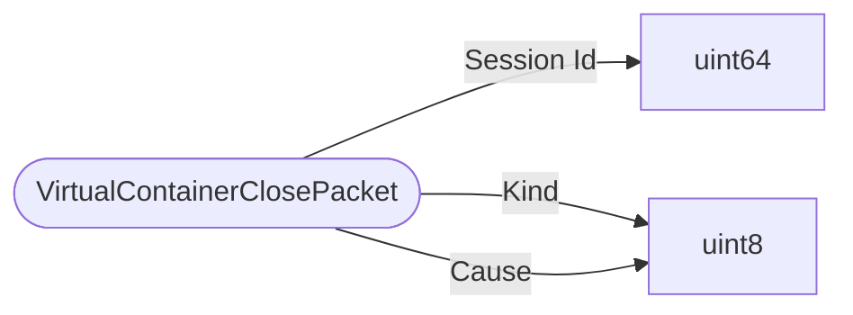

# VirtualContainerClosePacket

`packet` - id **367**

Request is server-to-client. Closed is client-to-server for opening failure, user close, or acknowledgement of a server request. Confirmed is server-to-client after inventory work drains. Successful opening sends no acknowledgement.

